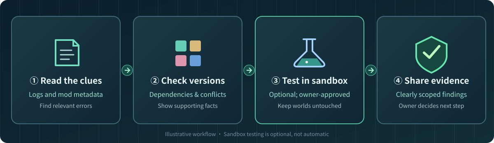

<div align="right">

**🌐 Language: English · [繁體中文 — 一鍵切換](README.md)**

</div>

# TotemOps · 不死圖騰

### When Minecraft breaks, stop guessing. Find the cause, check versions, and test before changing anything.

**An open-source helper for Minecraft server owners and mod developers.** Turn huge crash logs, confusing mod dependencies and risky updates into clear, evidence-backed next steps.

<p align="center">
  
</p>

<p align="center">
  <a href="README.md"><strong>🌏 繁體中文</strong></a> ·
  <a href="https://j0935586110-lgtm.github.io/TotemOps/?lang=en"><strong>🌐 Visual website (中文 / English)</strong></a> ·
  <a href="docs/ADVANCED_GUIDE.en.md">Full technical guide</a> ·
  <a href="https://github.com/j0935586110-lgtm/TotemOps/releases">Releases</a>
</p>

**Reuse established tools first:** [Modrinth](https://modrinth.com/) provides mod/version metadata; [mclo.gs](https://mclo.gs/) and [Crash Assistant](https://github.com/KostromDan/Crash-Assistant) provide existing crash analysis. TotemOps focuses on provenance, authorization and optional disposable-sandbox verification, not replacing mature tools. External log transfer is always opt-in. [Tool reuse and privacy boundaries](docs/EXISTING_TOOL_REUSE.md).

> **Current release: v0.1.0-alpha.1 (developer preview).** Read-only diagnosis and some authorized sandbox experiments are available. This is **not** a universal autonomous repair tool or a playable one-click Minecraft client installer.

---

## Does any of this sound familiar?

| The problem | How TotemOps can help | Status |
| --- | --- | --- |
| **Your server suddenly won't start.** The log is thousands of lines long. | Highlight relevant errors and suggest what to check next. | ✅ Available |
| **A newly added mod breaks the server.** You don't know what's missing. | Read mod metadata and flag declared dependencies, versions, and conflict clues. | ✅ Available |
| **Updating mods could break everyone's game.** | Review versions and update packages before making changes. | ✅ Review only; automatic updates unfinished |
| **You want new gameplay features** but don't know which mods to choose. | Find candidates for your Minecraft version/loader and show required dependencies. | 🧪 Candidate search available; full compatibility unverified |
| **Maintaining Forge/NeoForge code is exhausting.** | Help inspect repositories, identify version-related risks, and reuse existing development tools. | 🧪 Partially available |
| **New players keep asking for setup help.** | Review onboarding docs and update packaging; plan integration with existing launchers. | 🚧 Playable one-click installer not ready |

**The central rule: TotemOps does not get to delete mods, change your world, or update a live server just because an AI guessed the cause.**

## A real example: Waystones won't load

Imagine adding **Waystones**, only for the server to fail on startup.

**Before:** Read logs → search the web → guess which file to download → hope it works.

**With TotemOps:** Read the error and mod metadata → identify the missing **Balm** dependency → match versions → add Balm to a **disposable test server** → check whether Minecraft responds correctly.

We **actually reproduced and tested** this case using Minecraft 1.21.1 / NeoForge 21.1.259. Restoring the required dependency resulted in a successful server protocol-readiness check. We **did not test in-game teleporting**, so this is not proof that every gameplay feature works.



## Who is this for?

| You are | Where to start |
| --- | --- |
| **Server owner** | Diagnose `latest.log` and inspect the mods folder for declared dependencies. |
| **Modpack maintainer** | Check `.jar`, `.mrpack`, update ZIP and version information before distributing a pack. |
| **Forge / NeoForge developer** | Pair TotemOps with AGY, OpenCode or your existing coding agent to inspect repos and test ideas. |
| **Regular player** | Share your error log with a maintainer using TotemOps. You shouldn't need an AI agent just to play Minecraft. |

## How it works

1. **Observe first:** Read error logs, mod metadata and version information without changing files.
2. **Look for evidence:** Explain what the logs actually show, and say when a cause remains uncertain.
3. **Test only if authorized:** Optionally try a candidate fix in an isolated sandbox, not your real world.
4. **Report clearly:** Provide the findings so the owner can choose what to change.

### What works and what doesn't (yet)

| Available | Not available / not proven |
| --- | --- |
| Read-only mod and crash-log inspection | Autonomous repair of every Minecraft failure |
| Specific-release mod candidate lookup | Guaranteed compatibility across arbitrary mods |
| Selected sandbox downloads, checksums and server-protocol tests | Unapproved changes to production worlds |
| Modular plugins and agent-friendly command-line interface | A playable one-click Setup.exe |
| Release/package review and signed compatibility checks | Fully automatic world rollback |

## Try it (no AI account needed)

You need **Python 3.11 or newer**. For local log and mod inspection, **Docker and an AI API key are not required**.

```bash
git clone https://github.com/j0935586110-lgtm/TotemOps.git
cd TotemOps
python3 -m pip install -r requirements.txt

# Environment check
python3 tools/totem_operator.py doctor

# Diagnose a crash log without modifying the server
python3 tools/totem_operator.py quick diagnose /your-server/logs/latest.log

# Inspect local mod metadata; does not execute the JARs
python3 tools/totem_operator.py quick inspect /your-server/mods/
```

On Windows, use `py -3` instead of `python3`. Replace the sample paths with your own. You can also tell your coding agent: “**Use the TotemOps skill to explain this latest.log. Don't change any files.**”

For more commands and examples, see the [full English technical guide](docs/ADVANCED_GUIDE.en.md).

## What's next?

The roadmap includes better mod/patch relationships, more real server crash reproductions, owner-approved health/backup operations, safer reversible maintenance, and integration with existing launchers to simplify player updates. **These are goals, not shipping features.**

Tell us which repetitive task takes the most time in [GitHub Issues](https://github.com/j0935586110-lgtm/TotemOps/issues). Please redact IPs, account details, tokens, and player information before posting logs.

<details>
<summary><strong>For developers: evidence, safety and licensing</strong></summary>

First-party source code is [Apache-2.0](LICENSE). Read [Security Policy](SECURITY.md), [Contributing](CONTRIBUTING.md) and [Alpha release scope](docs/RELEASE_STATUS.md). Minecraft assets, private mods and account data are not bundled.

One Waystones/Balm test reached **PASS_PROTOCOL** after a real NeoForge missing-dependency repair. Five other fault classifications passed **synthetic-log tests**—not five separately verified live fixes.

TotemOps is an **unofficial Minecraft community project**, not endorsed or sponsored by Mojang Studios or Microsoft. Graphics are original concept illustrations, not captured gameplay screenshots.

</details>

---

<div align="center">

**🌏 [繁體中文 — 一鍵切換](README.md)** · **[English technical guide](docs/ADVANCED_GUIDE.en.md)**

</div>
