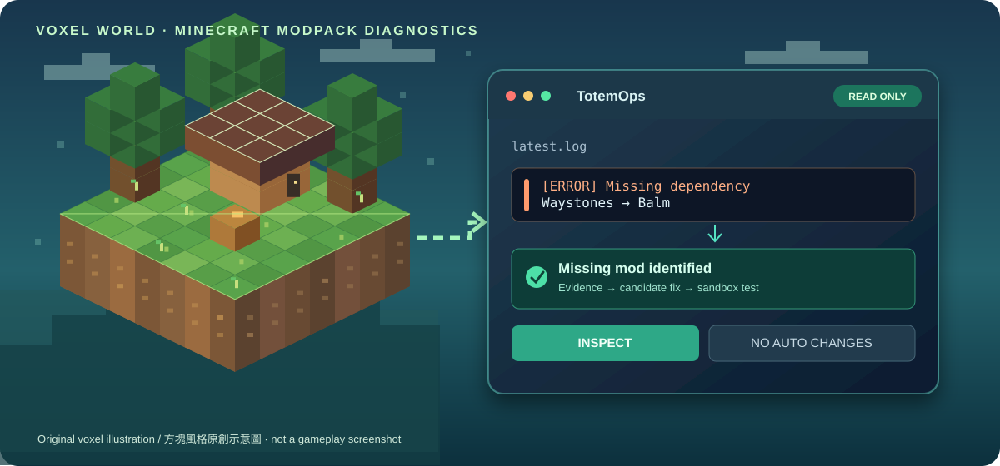
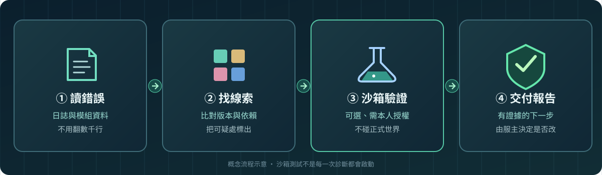

<div align="right">

**🌐 語言：繁體中文 · [English — 點一下切換](README.en.md)**

</div>

# 不死圖騰 TotemOps

### Minecraft 出問題，不用再靠猜。先找原因、確認版本，再決定怎麼修。

**給 Minecraft 服主與模組作者的開源小幫手。** 把很長的錯誤日誌、雜亂的模組版本與繁瑣的檢查工作整理成一份看得懂、有根據的報告。

<p align="center">
  
</p>

<p align="center">
  <a href="README.en.md"><strong>🌍 English</strong></a> ·
  <a href="https://j0935586110-lgtm.github.io/TotemOps/"><strong>🌐 中英雙語圖文網站</strong></a> ·
  <a href="https://j0935586110-lgtm.github.io/TotemOps/diagnose.html"><strong>🛡️ 免費分析 latest.log（瀏覽器本機）</strong></a> ·
  <a href="docs/ADVANCED_GUIDE.zh-TW.md">詳細使用手冊</a> ·
  <a href="https://github.com/j0935586110-lgtm/TotemOps/releases">版本下載</a>
</p>

> **目前是 v0.1.0-alpha.1 開發預覽版。** 已可做唯讀分析與部分經授權的沙箱實驗；**不是**一鍵自動修好所有 Minecraft，也**不是**讓玩家雙擊就能遊玩的正式安裝器。

---

## 你是不是遇過這些事？

| 😵 遇到的麻煩 | 🛠️ 不死圖騰能幫忙什麼 | 目前進度 |
| --- | --- | --- |
| **伺服器突然開不起來**，錯誤日誌幾千行，看不懂 | 把關鍵錯誤挑出來，指出可能原因和下一步要檢查的地方 | ✅ 可用 |
| **裝了新模組卻一直報錯**，不知道缺哪個前置 | 讀取模組檔案，檢查已宣告的依賴、版本與衝突線索 | ✅ 可用 |
| **更新模組很怕整台服壞掉** | 先比對版本、檔案與更新內容，列出需要確認的風險 | ✅ 先分析；自動更新未完成 |
| **想新增傳送、經濟或其他玩法**，不知道怎麼選模組 | 按 Minecraft 與 Loader 版本搜尋候選模組，列出前置需求 | 🧪 候選推薦可用；整套相容待實測 |
| **開發 Forge／NeoForge 模組很累**，還要顧 API、CI 與打包 | 幫作者整理程式庫、版本變更和測試方向，接原本的開發工具 | 🧪 部分功能已具備 |
| **一直要幫新玩家處理安裝、更新問題** | 檢查說明文件、安裝流程與更新包；未來串接現成啟動器 | 🚧 正式一鍵安裝仍在開發 |

**最重要的原則：不死圖騰先幫你找答案，不會因為 AI 猜到一個原因，就擅自刪模組、改世界存檔或更新正式伺服器。**

## 真的有用嗎？看一個實際例子

Minecraft 伺服器裝了 **Waystones（傳送石）**，結果開服失敗。

**以前：** 翻日誌 → Google 找文章 → 猜版本 → 一個一個試。

**用不死圖騰：** 讀取日誌與模組資料 → 發現缺少 **Balm** 前置模組 → 確認符合的版本 → 在**一次性測試伺服器**加回 Balm → 再次啟動並驗證協定是否正常回應。

這個案例我們**實際跑過**：Minecraft 1.21.1／NeoForge 21.1.259，修復缺失依賴後，伺服器通過連線協定檢查。**但沒有實際登入遊戲測試傳送功能**，所以不會宣稱「所有問題都修好了」。



## 誰適合用？

| 你是誰 | 最適合從哪裡開始 |
| --- | --- |
| **Minecraft 服主** | 把 `latest.log` 給不死圖騰分析，看可能故障與依賴問題 |
| **模組整合包作者** | 檢查 `.jar`、`.mrpack`、更新 ZIP 與版本搭配，避免盲目發布 |
| **Forge／NeoForge 開發者** | 搭配自己原本的 AGY、OpenCode 或其他開發 Agent，幫忙讀專案與整理錯誤 |
| **一般玩家** | 可以把錯誤日誌交給懂這套工具的朋友或開發者；目前不需也不建議為了玩遊戲先安裝 AI |

## 不死圖騰怎麼運作？

1. **先看，不亂動：** 讀取錯誤日誌、模組資訊與版本。
2. **用證據找線索：** 告訴你是哪個錯誤、缺少什麼、需要注意什麼；不確定就明說。
3. **你同意才測試：** 必要時在獨立沙箱嘗試修復，不拿正式玩家世界做實驗。
4. **報告結果給你：** 提供有根據的修改建議，正式伺服器是否更動由服主決定。

### 目前能做與還沒做的事

| 已經能用 | 還在開發／不能保證 |
| --- | --- |
| 唯讀分析 Minecraft 日誌與模組依賴 | 任意故障都能全自動修復 |
| 查詢指定版本模組的候選資訊 | 所有模組搭配一定相容 |
| 部分沙箱下載、校驗與實際開服驗證 | 不經批准直接修改正式世界 |
| 可選插件與不同 AI 共用的工具入口 | 玩家安裝 Setup.exe 後立即進服 |
| 發布包差異與簽章相容性檢查 | 可完全自動回滾世界資料 |

## 先試試看（不用 AI 帳號）

需要 **Python 3.11 以上**。只檢查日誌或模組時，**不用先裝 Docker，也不用提供 AI API Key**。

```bash
git clone https://github.com/j0935586110-lgtm/TotemOps.git
cd TotemOps
python3 -m pip install -r requirements.txt

# 看工具是否準備好
python3 tools/totem_operator.py doctor

# 分析你的錯誤日誌（不會修改伺服器）
python3 tools/totem_operator.py quick diagnose /你的伺服器/logs/latest.log

# 檢查模組資料夾（不會執行 JAR）
python3 tools/totem_operator.py quick inspect /你的伺服器/mods/
```

Windows 可把 `python3` 換成 `py -3`。路徑請換成你自己的。若沒有 Minecraft 專業知識，可請已安裝本專案的 AI 開發工具：「**用 TotemOps 幫我看這份 latest.log，先不要修改任何檔案。**」

## 取得修復處方（fixplan）

診斷出線索後，不用憑空猜測該改什麼。`fixplan` 會將日誌中的 9 種崩潰訊號轉化為**唯讀修復處方**：

```bash
# 人類可讀中文步驟（先確認、再變更、最後驗證）
python3 tools/totem_operator.py fixplan /你的伺服器/logs/latest.log

# 給 Coding Agent 的結構化 JSON
python3 tools/totem_operator.py fixplan /你的伺服器/logs/latest.log --json
```

- **安全邊界**：只讀日誌、不上傳、不改檔案、不自動修復；exit code `3` 代表「只有計畫，未執行任何變更」（`0` 不使用）。
- **最小揭露**：輸出僅含 `log_sha256` 與行號，不含日誌原文或絕對路徑；每份配方第一步皆為唯讀確認，會改檔案的步驟標註 `[需確認]`。

## 離線依賴閉包與整合包匯出（closure & packindex）

- **依賴閉包檢查**：不啟動遊戲、離線計算模組缺少的必要前置與版本衝突：
  `python3 tools/totem_operator.py closure /你的伺服器/mods/`
- **匯出 Modrinth 索引**：將本機模組轉為可分享的 pack index（有明確下載對照才寫出 `.mrpack`）：
  `python3 tools/totem_operator.py packindex /你的伺服器/mods/ --name "MyPack" --version "1.0.0" --minecraft 1.21.1 --loader neoforge`

**想看所有進階功能？** 參考 [完整中文手冊](docs/ADVANCED_GUIDE.zh-TW.md)，包含插件開關、相依查詢、沙箱測試、玩家更新包檢查與安全限制。

## 下一步要做什麼？

我們正在逐步實作：更完整的模組／補丁相依判斷、更多真實故障的沙箱驗證、服主的健康檢查和可回復維運流程，以及重用現成 Minecraft 啟動器來改善玩家安裝與更新體驗。**這些是計畫，不是已交付的功能。**

歡迎透過 [Issues](https://github.com/j0935586110-lgtm/TotemOps/issues) 告訴我們：你遇到什麼故障、目前最花時間的是哪一步。請先移除日誌中的 IP、帳號、Token 與玩家個資。

**需要給 AI 工具使用，或想研究程式碼？** 請看 [開發者快速開始（AGY／Claude Code／OpenCode）](https://j0935586110-lgtm.github.io/TotemOps/start.html)；Skill、JSON、Docker 與安全規則都放在獨立的技術頁面。

<details>
<summary><strong>開發者資訊、測試與安全聲明</strong></summary>

**現有工具優先，不重複造輪子：** 模組版本與依賴優先使用 [Modrinth](https://modrinth.com/)；Minecraft 崩潰問題可參考 [mclo.gs](https://mclo.gs/) 與 [Crash Assistant](https://github.com/KostromDan/Crash-Assistant)。不死圖騰重點是整合分析、保留證據、執行授權後的沙箱驗證，而不是取代這些成熟工具。[整合邊界與隱私說明](docs/EXISTING_TOOL_REUSE.md)。 **上游已有修補就優先借鏡，不再重做：** [NeoForge 真實 Issue #2472 驗證與上游 PR #3331 對照](docs/UPSTREAM_REUSE_TRIAL_2472.md)。

本專案採用 [Apache-2.0](LICENSE)，詳見 [安全政策](SECURITY.md)、[貢獻指南](CONTRIBUTING.md) 與 [Alpha 功能界線](docs/RELEASE_STATUS.md)。原程式碼不包含 Minecraft 本體、玩家私有模組或帳號資料。

一次 Waystones／Balm 依賴修復達成的是 **PASS_PROTOCOL（協定回應）**；另五種故障分類是**合成日誌測試**，不能當成五次實際開服修復。

這是**非官方 Minecraft 社群專案**，沒有獲得 Mojang Studios 或 Microsoft 的認可、贊助或背書。插畫為原創示意，並非遊戲截圖。

</details>

---

<div align="center">

**🌐 [English — Switch language](README.en.md)** · **[完整中文說明](docs/ADVANCED_GUIDE.zh-TW.md)**

</div>
