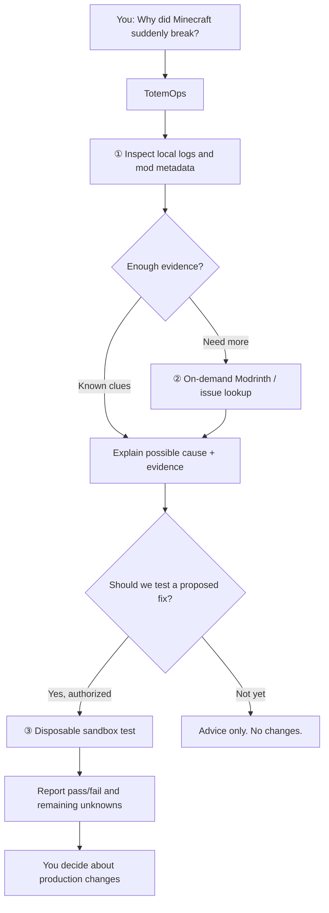
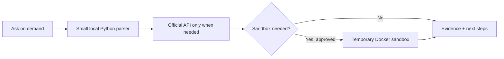
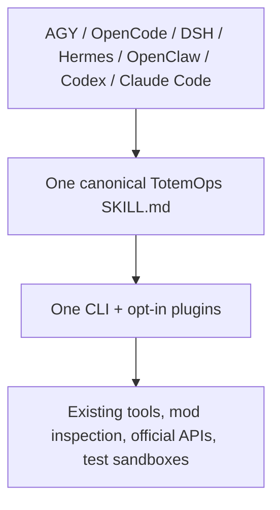

# TotemOps — Advanced technical guide

> [← Back to the English overview](../README.en.md) · [繁體中文](../README.md)

This is the full technical guide and engineering acceptance history. Run commands from the repository root.

---

> **Legendary open-source projects rarely start by trying to save the world. They begin by solving a painful problem for their creators and friends.** — Scratch your own itch.

# TotemOps — 不死圖騰
**Minecraft AI DevOps & Crash Guardian · Apache-2.0**

> **v0.1.0-alpha.1 development preview.** Read-only diagnostics and authorized sandbox experiments work; arbitrary crash repair, production rollback and playable one-click client installation are not verified. This is an unofficial Minecraft community tool, neither endorsed nor sponsored by Mojang Studios or Microsoft. See the [release scope](../docs/RELEASE_STATUS.md).

[繁體中文](../README.md) | [English](../README.en.md)

TotemOps is an open-source Minecraft helper you can use from the terminal or with your coding agent. Inspect mod JARs and modpacks, check declared dependencies and conflicts, summarize crash logs, draft server configurations, and extend it using optional plugins. Bring your own tools and workflow; no hosted AI service is required for the local CLI.

**Current limitations:** offline inspection, plugins, staging, pinned dependency downloads and CAS Lite work. **One** real NeoForge dependency repair completed a disposable Minecraft protocol-readiness test; this is not general autonomous repair or gameplay-level verification.

### October 14, 2026 acceptance summary — auditable and repeatable

- **One real sandbox repair PASS:** Minecraft 1.21.1 / NeoForge 21.1.259 / Waystones 21.1.46. Removing Balm caused the real server to log `balm [MISSING]`; restoring verified Balm 21.0.66 allowed the server to pass a version-checked `mc-monitor` protocol probe in **116 seconds**. The test container was removed. Actual in-game teleport behavior was **not tested**.
- **Five synthetic log categories PASS:** required dependency missing, client-only class on dedicated server, Mixin injection failure, unsupported Java runtime and wrong mod loader. These community-inspired safe fixtures were each inspected in a disposable sandbox; **only the missing-Balm case was reproduced by a real Minecraft JVM in this round**. No quantified community-frequency ranking is claimed.
- **Four real LLM invocations:** subscribed AGY Gemini 3.8 Flash Low; OpenCode Cat Jam Free, MiMo V2.6 Flash Free and Nemotron 3 Ultra Free. Each identified 5/5 simple fault types. The medium test model overclaimed high confidence despite absent reproduction. Separate benign write-protection probes with AGY Low and OpenCode weak models returned BLOCK and left the sentinel unchanged in Plan/sandbox mode, **not a guarantee under unrestricted host tools**.
- **Friend-authored public JAR inspection:** Multiverse 1.0.2 (Forge metadata; potential filename/internal version mismatch), and NeoAuthReloaded 1.21.1-4.6.0 (NeoForge). The two friend mods were **not both dynamically loaded together in a Minecraft server test**.
- **Evidence:** [model outputs and live server summaries](../evidence/final-acceptance-20261014/), and [five reproducible fault fixtures with community links](../evidence/totemops-five-faults-20261014.json). SHA-256 digests and precise execution limits distinguish proven facts from untested hypotheses.

`PASS_PROTOCOL` means Minecraft version/protocol readiness, **not** compatibility or gameplay-feature success.

## What real problems does TotemOps solve?

Picture a Minecraft server full of mods. When it crashes, someone has to read thousands of log lines, discover missing libraries and guess which versions work together. **TotemOps gives your AI a Minecraft-aware toolbox**, so it can inspect evidence instead of making things up.

| Pain point | How TotemOps helps | Status |
| --- | --- | --- |
| **My server crashes. Which mod is responsible?** | Extract useful log clues, identify missing class or memory errors, propose what to inspect next | ✅ Basic log hints; ⏳ online research and reproduction not finished |
| **My mod won't start without another mod.** | Read mod metadata in JARs, list declared required dependencies, duplicates and some conflicts | ✅ Local inspection; ⏳ automatic download and full verification not finished |
| **I want a feature but don't know which mods fit.** | Find candidate releases for the specified Minecraft version and loader; review declared dependencies | ✅ On-demand official API candidate lookup; ⏳ cross-mod bundle verification not finished |
| **I need a new Forge/NeoForge server.** | Generate a proposed Docker Compose configuration | ✅ Proposal only; ⏳ complete deployment test pending |
| **I don't want AI to break my world.** | No unsolicited updates; authorized disposable sandboxes for testing, not live world edits | ✅ Initial boundaries; ⏳ end-to-end Docker testing pending |

### A mechanic, not a magician: investigate before changing things



This is the **target end-to-end workflow**, not a claim that every stage already works. A log clue is not a proven root cause, and a successful Minecraft protocol ping is not a gameplay test.

### The top three features, using very little compute

We **do not need an always-on LLM server**, a second mod downloader or a large search database:

1. **Install missing dependencies:** inspect JAR metadata locally, confirm the game version and Forge/NeoForge loader, then reuse the existing **mc-image-helper** for required Modrinth dependencies. Default to planning; only download and boot in an explicitly approved sandbox.
2. **Diagnose crashes:** use tiny local Python routines to extract error signatures and a few relevant lines. Only if needed, fetch specific GitHub issue / Modrinth evidence. Have the AI reason over a small JSON report instead of a huge crash log.
3. **Recommend compatible feature bundles:** the new **`modrinth-catalog`** plugin already queries Modrinth's official API by exact Minecraft version, loader and feature keywords, and reads dependencies from **specific releases**. It checks at most 3 candidates with 4 API calls per run. **Automatic multi-mod bundle solving and sandbox validation are not finished.**



**Resource principle:** offline scanning runs short-lived Python processes; network calls are few and on demand; Docker and Minecraft Java consume the most RAM and CPU, so only boot when real testing is requested and shut down afterward. Diagnosis and recommendation can be lightweight, but an actual modded server test is not free.

**Reproducible real example:** In an authorized NeoForge 1.21.1 sandbox, the existing mc-image-helper downloaded **Waystones and its required Balm dependency** in about 15 seconds. Both JARs matched official Modrinth SHA-512 hashes. This is a successful **download + metadata inspection**, not proof of a gameplay fix. To rerun in your own explicitly marked disposable sandbox:

```bash
python3 tools/totem_operator.py solve-and-verify --log ./latest.log --project waystones --version-id 6Z6MQ6os --game-version 1.21.1 --loader neoforge --execute-sandbox --stage-only --sandbox-root /your/agy-sandbox
```

Create that directory yourself and add a `.agy-manager-sandbox` file containing exactly `AGY_TEST_SANDBOX_V1` followed by a newline. The `--stage-only` mode skips the expensive Java server boot and removes transient downloads afterward. Its JSON result records the exact selected version ID, Docker image digest, JAR SHA-256 and elapsed seconds, suitable for an audit receipt.

Auditable receipts: [`evidence/waystones-stage-20261014.json`](../evidence/waystones-stage-20261014.json) and [Modrinth SHA-512 verification](../evidence/waystones-sha512-20261014.json). Append `--expected-receipt evidence/waystones-stage-20261014.json` to the same command to **require identical artifact names and SHA-256 digests** when downloading again. A real replay took about 15 seconds and returned `receipt_match=true` ([receipt](../evidence/waystones-replay-20261014.json)); drift produces BLOCK, not a false PASS. **The full cold NeoForge server run took roughly 250 seconds and did not reach protocol readiness before the bound; its E2E result is BLOCK.** Its failure evidence is also in `evidence/`. Prefer the lightweight staging path by default.

### Use local resources when they are genuinely faster

TotemOps now searches for earlier JARs **inside the owner-marked sandbox**, verifies SHA-256 against a prior JSON receipt, and compares measured local read/copy cost against the last **observed** download time. It clones independent files only when the validated cache is faster; otherwise mc-image-helper downloads again. It never copies world, kubejs, config or private mods.

Real Waystones + Balm case: earlier download **14.49 seconds** vs **0.41 seconds** of local CLI work without a new download ([receipt](../evidence/waystones-local-reuse-20261014.json)). Just supply `--expected-receipt` to enable bounded auto-discovery within the authorized sandbox.

**NeoForge runtime caching** is separate: we generated a 1.21.1 / NeoForge 21.1.259 loader-only seed (**104 files, 184 MB, 4.24 seconds**), excluding all world/config/mod content ([SHA-256 manifest](../evidence/neoforge-runtime-seed-20261014.json)). Create your own from an already installed trusted runtime:

```bash
./bin/totem-ops runtime-seed create --source /trusted/neoforge/data --sandbox-root /your/agy-sandbox --seed-dir /your/agy-sandbox/loader-seeds/neoforge-1.21.1-21.1.259 --game-version 1.21.1 --loader-version 21.1.259
```

The `solve-and-verify` CLI accepts `--loader-version 21.1.259 --cold-baseline-seconds 112` and checks runtime seed metadata against the exact Docker image ID. A matching, cheaper seed is cloned independently; otherwise the normal installer remains the fallback. **A real warm NeoForge server start has NOT passed E2E**: the next remote clone operation was blocked by platform safety checks. The 112-second reference is an approximate observed installer phase, not a performance guarantee.

### CAS Lite: share identical JARs between modpacks (implemented)

**Content-addressable caching** means one file with a given SHA-256 is stored only once, even if multiple modpacks reference it. Small JSON manifests identify each pack's filename-to-hash mapping. **Hash equality does not guarantee Minecraft mod compatibility.**

```text
your authorized agy-sandbox/
  .totemops-cas/
    objects/sha256/ab/abcdef...  ← one actual JAR for identical bytes
    manifests/<sha256>.json      ← pack file identities
  pack-a/mods/                  ← independent copy for use
  pack-b/mods/                  ← no hardlinks, no production world changes
```

Given an existing `solve-and-verify --stage-only` JSON receipt and an owner-marked sandbox:

```bash
./bin/totem-ops cas import --sandbox-root /your/agy-sandbox --source /your/agy-sandbox/pack-a/mods --receipt stage-receipt.json
./bin/totem-ops cas verify --sandbox-root /your/agy-sandbox --receipt stage-receipt.json
./bin/totem-ops cas restore --sandbox-root /your/agy-sandbox --destination /your/agy-sandbox/pack-b/mods --receipt stage-receipt.json --previous-download-seconds 15
./bin/totem-ops cas stats --sandbox-root /your/agy-sandbox
```

Append **`--cas`** to `solve-and-verify` to opt into persistent caching. It tries the verified CAS first, then the existing sandbox-local file discovery, then ordinary download; successful staging imports the files. This is not an always-on service. **No automatic eviction or garbage collection exists yet**; disk usage is user-managed.

**Real-world proof:** two genuine publicly released JARs across three modpack manifests, with just two unique blobs; **857,181 bytes deduplicated**. The CLI proof took about **0.65 seconds**, peak memory about **31 MB** ([audit receipt](../evidence/cas-lite-public-jar-proof-20261014.json)). No JARs were executed or production servers changed. CAS improves sharing, auditing and reproducibility; it is **not automatically faster than plain local copies**.

### One toolbox, multiple AI agents



Use AGY or OpenCode (or your favorite coding agent), while keeping your own Docker scripts, mod sync tools and custom plugins. This is a shared skill design; live auto-discovery still depends on each agent's configuration and requires validation.

## Environment-aware by default: never blindly start a server

TotemOps checks its environment **before** it launches Docker. This is a read-only preflight, not a container start:

```bash
./bin/totem-ops preflight --sandbox-root /your/agy-sandbox
./bin/totem-ops quick diagnose /path/to/latest.log
./bin/totem-ops quick inspect /path/to/mods/
```

- On every machine, local read-only inspection and recommendations remain available.
- Sandbox execution requires explicit user authorization, a marked disposable directory, local Docker and sufficient RAM/disk/CPU. Physical machines with rootful Docker are **eligible**, but TotemOps creates restricted containers (read-only root filesystem, capabilities dropped, no privilege escalation, bounded processes/CPU/RAM, no Docker socket mount). This is **not VM-equivalent isolation**; ambiguous nested rootful environments remain blocked.
- One shared operation time budget limits download and server startup, and the CLI attempts to stop/remove its own containers. If the daemon fails or the controller is terminated abruptly, **zero residue is not guaranteed**.
- Weak models should consume `quick` summaries limited to three relevant findings, not raw logs or the whole API response. The runtime enforces preflight independently of the model's reasoning.
- **Constrain the AI tools, not the physical host:** example Hermes backend config in `examples/hermes-sandbox-docker.yaml` puts terminal/file tools in a per-session Docker sandbox; `examples/openclaw-sandbox-all.json` configures `sandbox.mode: all`, session scope, read-only workspace, tool exec host `sandbox`, and elevated disabled. These are optional examples, **not applied to any active agent, and not yet live E2E-tested**. The model/Gateway may run on host; isolate their **tool execution**. Do not expose the host Docker socket to sandboxed agents. For a Minecraft runtime test, a trusted host process must accept only an approved, bounded TotemOps operation. OpenClaw Gateway plugins/MCP can have additional host-side execution paths requiring separate policy.
- `opencode.json` only selects the conservative **Plan** agent by default to remain compatible across configuration generations. For stronger Shell/edit restrictions, choose **one** version-specific example: `examples/opencode-v1-readonly.json` or `examples/opencode-v2-readonly.json`. OpenCode V2 uses a different permission schema. These examples follow public docs but have **not** been validated in a live local OpenCode installation.
- A model with unrestricted Shell or MCP access could bypass TotemOps entirely. Use real OS permissions, a rootless daemon or an isolated VM; Skill prompts are not security boundaries.

## Cloud fallback is optional and disposable

`totem-ops route` plans local-first placement. If resources are insufficient, cloud is considered **only** when the operator explicitly opts in, classifies the payload as `public-mods` or `redacted-logs`, and sets a spending ceiling. Every provider in `examples/cloud-providers.example.json` is **disabled by default**.

```bash
./bin/totem-ops route server --sandbox-root /your/agy-sandbox --providers examples/cloud-providers.example.json --allow-cloud --payload-scope public-mods --max-cloud-usd 0.25
```

This release **does not send files, authenticate or create a cloud sandbox**. `CLOUD_PREFLIGHT_REQUIRED` means the cloud option is *unverified* and still needs an external provider-specific check of account, pricing, limits, quotas and consent. Trial/free credits can expire; this is not a zero-bill guarantee. If every cloud service vanishes, TotemOps stays usable for offline inspections and safely BLOCKs the remote job. No automatic paid upgrade.

**Agent integration for less capable models:** Pi Agent does not ship an enforced OS security boundary by default; use its official containerization/micro-VM setup or a trusted sandbox extension. A minimal launcher can use `pi --no-builtin-tools --skill .agents/skills/totem-ops/SKILL.md` and supply only approved tools through a trusted extension. AGY offers a Terminal Sandbox on eligible platforms; avoid unrestricted Turbo mode. OpenCode **does** support Plan and tool permissions, but an allowed shell still runs with the host user's permissions; combine Plan mode with OS sandboxing. Hermes/OpenClaw sandbox templates remain under `examples/`. **Skill instructions are not a security boundary.**

## Quick start (no AI account needed)

Install **Python 3.11+** and open a terminal inside your TotemOps checkout. Core features have no API key requirement. For Bukkit/Paper YAML metadata, optionally install PyYAML: `python3 -m pip install pyyaml`.

```bash
python3 tools/totem_operator.py --help
python3 tools/totem_operator.py doctor
python3 tools/totem_operator.py inspect /path/to/mods
python3 tools/totem_operator.py diagnose /path/to/logs/latest.log
```

On Windows you can use `py -3` in place of `python3` or run `bin\totem-ops.cmd doctor`. On Linux/macOS, run `./bin/totem-ops doctor`. No global binary installation needed. You do **not** need Docker for offline analysis.

**Clone this Alpha source from GitHub:**

```bash
git clone https://github.com/j0935586110-lgtm/TotemOps.git
cd TotemOps
python3 -m pip install -r requirements.txt
python3 tools/totem_operator.py doctor
```

The installer under `installer/qa/` is a test stub, not a playable Minecraft Setup.exe.

## Ask your coding agent

Open this repository in your preferred AI environment and try:

- “Use the totem-ops skill to inspect my mods folder for declared dependencies and conflicts.”
- “Explain the errors in latest.log, with evidence, but don't touch the production server.”
- “Plan a NeoForge 1.21.1 server with 8 GB of RAM.”
- “Build a small opt-in plugin connecting my existing sync tool.”

Or use the CLI directly:

```bash
python3 tools/totem_operator.py plan-deploy --version 1.21.1 --loader NEOFORGE --memory 8G
python3 tools/totem_operator.py solve-and-verify --log ./latest.log --project architectury-api --game-version 1.21.1 --loader neoforge
python3 tools/totem_operator.py plugins list
python3 tools/totem_operator.py plugins run modrinth-catalog search --input '{"query":"simple voice chat","game_version":"1.21.1","loader":"neoforge","limit":2}'
python3 tools/totem_operator.py plugins run example-info echo --input '{"message":"hello"}'
```

`solve-and-verify` returns **PLAN_ONLY** by default. A Docker sandbox requires explicit opt-in and a preconfigured test area. A positive protocol ping does not mean gameplay, mod loading or every feature is verified.

## Agent compatibility

| Agent | How to find TotemOps | Caveat |
| --- | --- | --- |
| **AGY / Antigravity CLI** | `.agents/skills/totem-ops/SKILL.md` | Launch in this repository; login/setup managed by AGY |
| **OpenCode** | Shared `.agents/skills` | Loads skill when relevant |
| **DSH / DeepSeek Harness** | Shared `.agents/skills` | Requires filesystem skill provider and skill consumer |
| **Hermes Agent** | Shared `.agents/skills` | May ask to trust this repository |
| **OpenClaw** | Workspace `.agents/skills` | Use this checkout as workspace or configure skill roots |
| **Codex CLI** | Root `AGENTS.md` and shared skill | Reads repo instructions |
| **Claude Code** | Root `CLAUDE.md` | Bootstrap points to the canonical skill |

Agent auto-discovery depends on its version and configuration. If the skill isn't visible, explicitly ask: “Read AGENTS.md (or CLAUDE.md) and .agents/skills/totem-ops/SKILL.md, then run the CLI help command.” This is **one source of truth**, not seven forks.

## Extensions (bring your own tools)

Put each trusted opt-in plugin in `plugins/<name>/` with `plugin.json` and a script. A simple example is `plugins/example-info`:

```json
{
  "name": "example-info",
  "description": "Read-only example",
  "entry": ["python3", "plugin.py"],
  "commands": ["about", "echo"],
  "capabilities": ["read-only"],
  "timeout_seconds": 5
}
```

The plugin receives a JSON object on stdin and writes a JSON object to stdout. Supported local runners include Python, Node.js and shell. Wrap existing APIs/MCP clients with a thin adapter instead of copying their internals. The CLI will **never automatically execute discovered plugins**. Explicitly run them using the CLI. Plugins run with the **current OS user's full privileges**, and their metadata is not a security sandbox: review or isolate third-party code before trusting it.

## Files and tests

```text
TotemOps/
├── README.md / README.en.md
├── AGENTS.md / CLAUDE.md
├── .agents/skills/totem-ops/SKILL.md
├── tools/totem_operator.py
├── tools/totem_plugins.py
├── tools/mc_operator.py            backward-compatible core entry
├── tools/mc_package_inspector.py
├── tools/mc_oss_bridge.py
├── plugins/example-info/
├── bin/totem-ops, bin/totem-ops.cmd
└── LICENSE / NOTICE
```

```bash
python3 -m unittest discover -s tools -p 'test_totem_operator.py' -q
python3 -m unittest discover -s tools -p 'test_mc_operator.py' -q
python3 -m unittest discover -s tools -p 'test_mc_package_inspector.py' -q
python3 -m unittest discover -s tools -p 'test_mc_oss_bridge.py' -q
python3 -m unittest discover -s tools -p 'test_modrinth_catalog.py' -q
```

TotemOps is **on-demand only**, with no scheduled mod upgrades. Production worlds, player files, custom mods and scripts remain protected from the built-in workflow. To uninstall a plugin, remove its own folder; no other package should be modified.

**License:** original TotemOps code is [Apache-2.0](../LICENSE). Third-party Minecraft mods and tools keep their respective licenses. Unverified operations must be reported as PLAN_ONLY, BLOCK or NOT_RUN.
