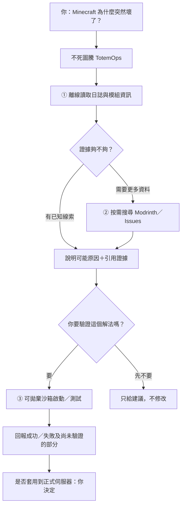
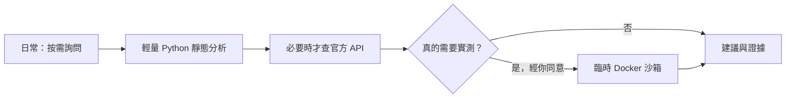
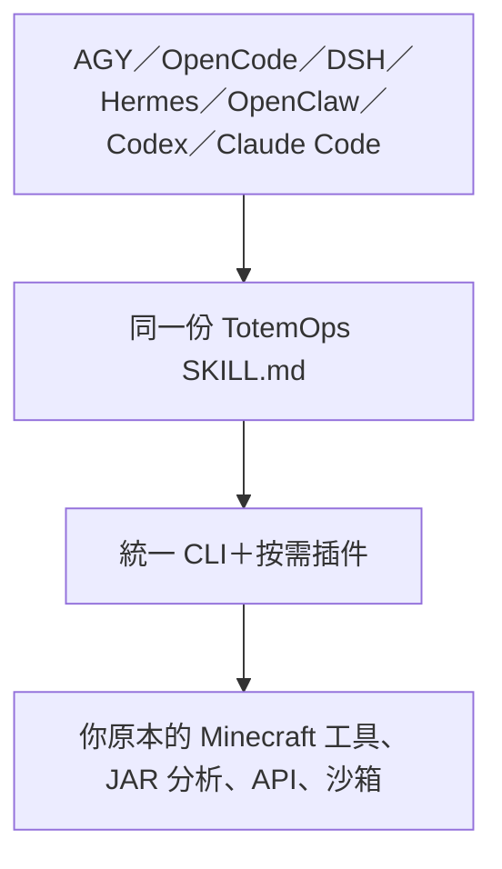

# 不死圖騰 — 進階中文手冊

> [← 回到白話中文首頁](../README.md) · [English](../README.en.md)

以下為完整技術說明與工程驗收紀錄；程式指令請從專案根目錄執行。

---

> **所有的傳奇開源專案，最初都不是為了做「拯救世界的大平台」，而是為了解決「自己和身邊朋友最痛苦的那件事」（Scratch your own itch）。**

# 不死圖騰 TotemOps
**Minecraft AI DevOps & Crash Guardian · Apache-2.0**

> **v0.1.0-alpha.1 開發預覽版。** 唯讀診斷及經授權的沙箱實驗可使用；任意故障自動修復、正式伺服器回滾及玩家端一鍵安裝尚未完成。此為非官方 Minecraft 社群工具，未獲 Mojang Studios 或 Microsoft 認可或贊助。完整驗收界線參見 [發布狀態](../docs/RELEASE_STATUS.md)。

**新手入服流程靜態稽核：** python3 tools/totem_operator.py onboarding inspect --repo-dir REPO --entry main.py --readme README.md。比對 README 的參數拼字與 Python 程式原始碼，提示 PCL／Prism 教學 TODO；只產生有來源行號的候選問題，不執行同步器、不改朋友檔案、也不代表實機安裝已成功。適用任意類似 Python 工具，不把朋友名稱寫死在核心。

**版本相容性／可信更新檢查（只讀）：** python3 tools/totem_operator.py release gate --help。驗證由服主簽署的版本資訊與 HTTPS 更新端，重大 Loader/Java/接口更動必須人工重新驗收。只有更新來源可信、版本相容，才允許繼續呼叫既有同步器；本工具不下載或改檔。相關說明 evidence/SIGNED_RELEASE_COMPATIBILITY_PROTOTYPE_20261014.md。

**玩家端啟動器可選模組（離線規劃）：** `python3 tools/totem_operator.py modules list`；新的 `launcher-plan` 預設 OFF，可由 switchboard 獨立開／關，或明確執行 `plugins run launcher-plan inspect`。只產生 Prism CLI 參數與 Barian 原同步器／Packwiz／AutoModpack 的必要驗收，不下載、不安裝、不進服；參閱 `docs/CLIENT_LAUNCHER_ADAPTER_20261014.md`。

**Minecraft 整合包發布驗收（本地唯讀）：** `python3 tools/totem_operator.py release inspect --pack /path/client.zip --update /path/update.zip`。分析 CurseForge Manifest、可選模組數量、更新包 README 刪除操作與覆蓋檔案 SHA-256，輸出 `REVIEW_REQUIRED` JSON 給服主核准。**只生成預覽，不刪 JAR、不重寫同步器，也不代表遊戲已啟動。** AGY/OpenCode Skill：`.agents/skills/minecraft-release/SKILL.md`；已用 MC8 3.5.0 公開 ZIP 實測，證據 `evidence/MC8_RELEASE_REVIEW_20261014.json`。

**新：兩個朋友的公開專案實證工作流。** `python3 tools/totem_operator.py friend-flow --help`：Barian 優先減少玩家安裝/更新的手動步驟，重用原 modsync-v2；chyuaner 優先追蹤 API 變更對自有同步器的影響，不假設 Barian 使用同一 API。全部是公開來源唯讀靜態分析，並非已完成雙擊安裝或真實 API 測試。

**開發者／AGY 模式（兩位朋友專用）：** 不死圖騰除了診斷 Minecraft，還可透過 `.agents/skills/minecraft-repo-maintainer/SKILL.md` 讓 AGY 了解 Barian0517 與 chyuaner 的公開程式庫，在隔離 worktree 產生最小修復 diff、用既有 Gradle/CI/客戶端工具測試。唯讀入口：`python3 tools/totem_operator.py maintainer profiles`；Repo Profile 見 `profiles/`。未經 repo owner 核准不可 push 或發 PR，STATIC_ONLY 不等於 Build/Game/UI 成功。實際首輪驗收：`evidence/FRIEND_MAINTAINER_20261014.md`。

[繁體中文](../README.md) | [English](../README.en.md)

這是一個讓你跟 AI 說人話就能排查 Minecraft 伺服器問題的開源工具包。AI 可以幫你看模組 JAR／模組包、整理相依關係、分析崩潰日誌、提出開服設定與可測試的修復方案。你可以像用 DSH 一樣自己加插件、換工具、改流程，不必接受某個固定的黑盒服務。

**最重要的差別：**本地分析、插件介面、部署方案、指定版本 Modrinth 依賴下載與 SHA-256 快取已可執行。**Waystones 缺 Balm → 補 Balm → NeoForge 伺服器協定就緒**已完成一次真實沙箱驗收；但自動修好任意世界、任意模組組合相容及所有故障自動修復仍未完成。

### 2026-10-14 收尾驗收（可以自己重跑）

- **真實開服修復 1/1 PASS：**Minecraft 1.21.1／NeoForge 21.1.259，故意只放 Waystones 21.1.46、移除必要的 Balm → 真實日誌出現 `balm [MISSING]` → 補回已校驗的 Balm 21.0.66 → 重新開服 **116 秒**，`mc-monitor` 協定就緒 PASS，沙箱容器已移除。此測試**沒有實際在遊戲內傳送**。
- **五種社群常見故障 5/5 PASS（僅離線）：**必要依賴缺失、客戶端模組誤放、Mixin 失敗、Java 版本不合、載入器不相容。從真實社群議題歸納成可公開的**合成日誌**，放在獨立沙箱執行 `totem-ops quick diagnose`；不是宣稱五種都經過完整 Java 開服實驗，也沒有依社群件數做嚴格頻率排名。
- **跨 Agent 盲測：**AGY 訂閱 Gemini 3.8 Flash Low、OpenCode Cat Jam Free／MiMo V2.6 Flash Free／Nemotron 3 Ultra Free，各 **5/5** 類型正確。中階模型把未驗證的判斷當作高信心，顯示仍需以工具收據取代模型信心。低階 AGY／OpenCode 的無害測試檔修改請求，在 Plan／沙箱模式下均被 BLOCK，原檔未更動；**不代表任意高權限 Shell 也安全**。
- **朋友公開 JAR 靜態檢查：**Multiverse `1.0.2`（Forge 中繼資料，檔名與內部版本候選不一致）及 NeoAuthReloaded `1.21.1-4.6.0`（NeoForge）已檢查；**兩款朋友模組沒有在這次 Java 沙箱一起運行**，也未修改或公開他們的檔案。
- **審查證據：**[`evidence/final-acceptance-20261014/`](../evidence/final-acceptance-20261014/) 保留模型原始 JSON、同一題目的測試提示、五種日誌分類、實際故障／修復摘要與原始 SHA-256；[`evidence/totemops-five-faults-20261014.json`](../evidence/totemops-five-faults-20261014.json) 保留案例及社群參考來源。

**驗收分級：**`PASS_PROTOCOL` 僅表示 Minecraft 協定可回應且版本符合，不表示玩家操作、模組完整功能及朋友的私有模組相容性都已驗證。

## 不死圖騰能幫你解決什麼？（白話版）

想像你管理一個裝了很多模組的 Minecraft 伺服器。以前它壞了，你可能要翻上千行日誌、查每個模組的版本，然後一個個嘗試。**不死圖騰就是讓 AI 有一個懂 Minecraft 的工具箱**，而不是靠 AI 憑空猜答案。

| 你的困擾 | 不死圖騰幫你做什麼 | 目前做到哪裡 |
| --- | --- | --- |
| **伺服器突然崩潰**，不知道哪個模組害的 | 濃縮錯誤日誌、找出可能缺少的類別或記憶體問題，指出下一步該檢查什麼 | ✅ 基本線索分析；⏳ 網路找解法＋自動驗證待完成 |
| **下載一個模組，發現還缺其他前置** | 看 JAR 裡的模組資訊、必要依賴、部分衝突與版本差異 | ✅ 本機靜態分析；⏳ 自動下載與完整驗證待完成 |
| **想要特定功能**，不知道模組怎麼搭 | 按 Minecraft／Loader 版本搜尋候選及該版本宣告依賴，再逐步確認組合 | ✅ 官方 API 候選查詢；⏳ 多模組組合／沙箱相容驗證待完成 |
| **想架一台新服**，設定麻煩 | 產生 NeoForge／Forge 的 Docker Compose 開服提案 | ✅ 產生設定；⏳ 完整開服驗收待完成 |
| **怕 AI 把世界、私有模組改壞** | 預設不更新；真要動手，只在明確指定的獨立沙箱試 | ✅ 基本限制；⏳ 真實端到端驗收待完成 |

### 像維修員一樣，先查原因再動手



這是**目標完整流程**，不是所有步驟都已做好。診斷線索 ≠ 確認根因；Minecraft 連線成功 ≠ 遊戲玩法或模組功能已驗證。

### 目前最想完成的 1＋2＋3，怎麼做到又快又省？

我們**不養一台常駐 AI 伺服器**，也不自己造模組下載器／搜尋引擎：

1. **自動補齊依賴：**現在的 JAR 分析器先抓缺件線索；確認遊戲版本與 Forge／NeoForge 後，用現成 **mc-image-helper** 從 Modrinth 下載必要依賴。預設先提出方案，授權後只在沙箱下載、試跑。
2. **崩潰診斷與修復：**Python 先從長日誌擷取少量錯誤特徵；查不出來才按需查 GitHub Issues／Modrinth。AI 只看精簡證據，提出可驗證的假說，而不是每次把整份日誌塞進模型。
3. **功能組合推薦：**已有 **`modrinth-catalog`** 可按遊戲版、Loader 和關鍵字查 Modrinth 官方 API，取得**具體發布版**及宣告依賴；單次最多讀取 3 個候選、發出 4 次請求。**跨模組組合推理與沙箱測試還沒完成**，候選清單不代表整套相容。



**耗能原則：**日常掃描只啟動短命 Python 行程；官方 API 查詢只在需要時發出少量請求；Docker／Minecraft Java 伺服器是最吃記憶體的步驟，**只有明確要求驗證才啟動，跑完關閉**。因此推薦與診斷本身很輕，但完整開服驗證不可能像文字分析一樣省資源。

**已實測的第一個例子：** NeoForge 1.21.1 的 Waystones `6Z6MQ6os` 必須搭配 Balm。我們在授權沙箱中用 `mc-image-helper` 成功取得 **Waystones＋Balm 共兩個 JAR**，約 15 秒，SHA-256 與 Modrinth 官方 SHA-512 已核對。這是**下載＋靜態檢查成功**，不是遊戲功能已實測。可複製的 CLI 操作（只有自己明確準備隔離目錄後才執行）：

```bash
python3 tools/totem_operator.py solve-and-verify --log ./latest.log --project waystones --version-id 6Z6MQ6os --game-version 1.21.1 --loader neoforge --execute-sandbox --stage-only --sandbox-root /你建立的/agy-sandbox
```

沙箱目錄必須由使用者建立，並放入內容為 `AGY_TEST_SANDBOX_V1` 加換行的 `.agy-manager-sandbox` 標記。`--stage-only` 只下載並驗證中繼資料，**跳過昂貴的 Minecraft Java 開機**，暫存檔跑完自動移除。命令輸出的 JSON 包含 Docker image digest、確切 Modrinth 版本 ID、JAR SHA-256 與秒數，可自己重導向為可稽核的收據。

真實執行紀錄在 [`evidence/waystones-stage-20261014.json`](../evidence/waystones-stage-20261014.json) 和 [官方 SHA-512 核對紀錄](../evidence/waystones-sha512-20261014.json)。使用相同指令加上 `--expected-receipt evidence/waystones-stage-20261014.json`，可要求**所有下載檔案與舊收據的 SHA-256 完全一致**；二次實測約 15 秒、`receipt_match=true`，見 [重跑證據](../evidence/waystones-replay-20261014.json)。如有版本漂移則 BLOCK，不把更新檔當舊檔。**完整 NeoForge 冷啟動花了約 250 秒、協定就緒逾時，因此 E2E 結果是 BLOCK**；原始失敗收據和時間歸因在 `evidence/`。日常以輕量檢查為主，只有需要時才開服試跑。

### 本機快取優先：有就重用，真的下載更快才重新抓

TotemOps 現在能在**已授權的沙箱**內自動尋找舊 JAR，先用 SHA-256 對照上次的 JSON 收據，再比較**本地讀取／複製的實測估算**和**上次下載耗時**。只有來源一致且估算較快才複製；否則使用 mc-image-helper 重新下載，絕不複製 `world/`、`config/`、`kubejs/` 或私有模組。

Waystones＋Balm 的實際例子：重抓約 **14.49 秒**；本機來源驗證和複製的 CLI 計時 **0.41 秒**，沒有發起網路下載，詳見 [快取收據](../evidence/waystones-local-reuse-20261014.json)。只要沿用 `--expected-receipt`，CLI 就會在沙箱內自動嘗試搜尋已有的同一組 JAR；不需要額外常駐服務。

**更大的瓶頸是 NeoForge Loader 冷安裝。** 我們已在自己的空白測試環境建立 **NeoForge 21.1.259／Minecraft 1.21.1** 的純 Loader 快取：只保存 `libraries/`、啟動腳本與版本清單，共 **104 個檔案／約 184 MB**，建立約 **4.24 秒**，完整 [快取內容雜湊清單](../evidence/neoforge-runtime-seed-20261014.json)。它不包含玩家世界、設定或模組；日後可比對 Docker image ID／Minecraft／Loader 版本後獨立複製。

你也可以用 CLI 從自己**已完成安裝、可信任**的 NeoForge `/data` 建立乾淨快取（不得使用別人的私有模組或未確認來源）：

```bash
./bin/totem-ops runtime-seed create --source /你的/NeoForge/data --sandbox-root /你的/agy-sandbox --seed-dir /你的/agy-sandbox/loader-seeds/neoforge-1.21.1-21.1.259 --game-version 1.21.1 --loader-version 21.1.259
```

`solve-and-verify` 可指定 `--loader-version 21.1.259 --cold-baseline-seconds 112`；如版本、Docker 映像與本地快取吻合，程式會優先估算複製成本，否則回到原始安裝。這個 Loader **熱啟動尚未通過真實 E2E**：原定複製實測被遠端平台安全檢查阻擋，不能把 Seed 建立成功誤寫成熱開服成功。冷安裝的 112 秒是該次操作由啟動到寫入安裝清單的近似時間，不是保證。

### CAS Lite：多個整合包共用同一份模組（已實作）

**內容定址快取（Content-Addressable Cache）** 的概念很簡單：同一個 JAR 即使出現在十個整合包，也只保存一次真正的檔案。用 `SHA-256` 當內容身分，再用小型 JSON Manifest 記錄整合包有哪些檔案。**這只能證明檔案內容相同，不能保證它們在 Minecraft 中相容。**

```text
你授權的 agy-sandbox/
  .totemops-cas/
    objects/sha256/ab/abcdef...  ← 真正的 JAR（同雜湊只存一份）
    manifests/<sha256>.json      ← 整合包檔名、雜湊、候選版本
  pack-a/mods/                  ← 使用時複製獨立檔案
  pack-b/mods/                  ← 不使用硬連結、不動正式世界
```

已有經 `solve-and-verify --stage-only` 產生的 JSON 收據時，在**已建立標記**的沙箱內，可以使用：

```bash
# 先把已下載且驗證過的 mods 放進 SHA-256 內容庫
./bin/totem-ops cas import --sandbox-root /你的/agy-sandbox --source /你的/agy-sandbox/pack-a/mods --receipt stage-receipt.json
# 驗證快取（不啟動 Minecraft）
./bin/totem-ops cas verify --sandbox-root /你的/agy-sandbox --receipt stage-receipt.json
# 還原到全新、空白的整合包目錄
./bin/totem-ops cas restore --sandbox-root /你的/agy-sandbox --destination /你的/agy-sandbox/pack-b/mods --receipt stage-receipt.json --previous-download-seconds 15
# 查實際儲存容量、共享節省多少
./bin/totem-ops cas stats --sandbox-root /你的/agy-sandbox
```

平常若透過 `solve-and-verify` 工作，只要額外指定 **`--cas`**，就會先找 CAS、再找原有 JAR、最後才下載；驗證完成後把同一組檔案放進 CAS。這是**明確選用功能**，沒有常駐服務，也沒有自動刪除；儲存空間要由使用者管理。

**真實測試：**兩位朋友公開發表的兩個 JAR，跨三份整合包 Manifest 共用兩個 blobs，省下 **857,181 bytes** 的重複儲存。CLI 完整測試約 **0.65 秒**、峰值約 **31 MB**。見 [可審查收據](../evidence/cas-lite-public-jar-proof-20261014.json)。測試沒有執行 JAR、沒有碰正式 Minecraft 伺服器。CAS 主要改善**去重、管理與可復現**；不保證比已經很快的普通本機複製更快。

### 為什麼要支援這麼多 AI？



Barian 想用 AGY，chyuaner 想用 OpenCode，工具底層還是同一份；兩位工程師可保留自己的模組同步器、Shell 腳本和私有插件，不需要換掉原來的工作流程。**這是跨 Agent 共用設計，七種 Agent 的自動技能啟用仍要各自實機驗證。**

## AI 不會亂開服：環境自動感知（已實作）

不死圖騰的原則是 **先檢查環境，再決定可不可以執行**。檢查只讀本機資源與 Docker 權限，**不開容器、不改主服**：

```bash
./bin/totem-ops preflight --sandbox-root /你的/agy-sandbox
./bin/totem-ops quick diagnose /你的/logs/latest.log
./bin/totem-ops quick inspect /你的/mods/
```

- **任何電腦**：預設只允許唯讀分析和提出修復提案。
- **執行前**：檢查本地 Docker 是否可用、機器類型、可用 RAM／硬碟與 CPU 數量。不夠就 `BLOCK`；VM 偵測僅是啟發式訊號。
- **實體機也能執行**：即使 Docker daemon 為 Rootful，只要經主人明確授權、路徑／資源檢查合格，就允許 TotemOps 使用**受限容器**（唯讀容器根檔案系統、移除 capabilities、禁止權限提升、行程／CPU／RAM 上限，僅掛載一次性測試資料）。這是便利與風險的折衷，**不是 VM 級隔離**；巢狀容器＋不明高權限 daemon 仍拒絕。
- **長任務**：統一時間預算，超時 BLOCK，嘗試停止／清理自己建立的容器。若 Docker daemon 失聯或程式被強制殺掉，**無法保證零殘留**，需人工確認。
- **低階模型**：只讀 `quick` 的精簡 JSON（最多 3 項關鍵線索）；程式驗證輸入、資源與環境。**AI 只提案，不是授權來源**。

**把 AI 的工具強制放進沙箱（借鏡 Hermes／OpenClaw）：**

- **Hermes**：參照 `examples/hermes-sandbox-docker.yaml`，使用 `terminal.backend: docker`、每個工作階段獨立容器、限制資源與環境變數，不把 Docker socket、SSH 密鑰及正式 Minecraft 目錄掛進去。
- **OpenClaw**：參照 `examples/openclaw-sandbox-all.json`，設定 `sandbox.mode: all`、`scope: session`、`workspaceAccess: ro`、`tools.exec.host: sandbox` 並停用 elevated。不是 `non-main`，避免主會話漏出沙箱。
- **底層分工**：模型與 Gateway 不一定住在容器內；**真正被隔離的是 Shell／檔案工具**。沙箱內不要給模型主機的 Docker socket。若要驗收 Minecraft，就由受信任的主機流程按核准過的固定 TotemOps CLI 規格執行，不能讓任意 AI Shell 直接控制主機 Docker。

以上為**可選配置範本，尚未寫入你正在使用的 Hermes 或 OpenClaw 設定，也未在這兩套 Agent 上完成端到端驗收**。OpenClaw 的 MCP／原生插件可能由 Gateway 執行，仍需另外檢查工具權限。

OpenCode 倉庫內的 `opencode.json` **僅設定 Plan 為預設 Agent**，避免新舊版權限格式衝突。若要更嚴格限制 Shell／檔案編輯，請依自己安裝的版本套用 `examples/opencode-v1-readonly.json` 或 `examples/opencode-v2-readonly.json`，**不能混用兩種格式**。這兩份設定是依公開文件建立的範例，尚未經本機實裝 OpenCode 驗證。進階工程師可以自行調整 Agent 權限，但**直接透過任意 Shell／MCP 執行 Docker 可以繞開 TotemOps 指令內的檢查**；真正隔離要靠作業系統權限、Rootless Docker 或獨立 VM。

## 本機不足時改雲端：不綁定免費服務（薄介面）

```text
你的任務 → 本機 preflight → 本機夠用？ → 本機受控沙箱
                                └─ 不夠 → 你允許雲端？
                                          ├─ 不允許／敏感檔／無額度 → BLOCK
                                          └─ 已啟用的候選提供商 → 先核對費用、配額、身份及環境
                                                                     └─ 驗證成功後才可派送
```

新增唯讀 `route` 命令。預設 `examples/cloud-providers.example.json` 的所有雲端服務**都關閉**，不放 API Key、不連線、不傳檔、不花錢。這次只實作**本機 vs 雲端候選選擇**，雲端下單與回收還未接通，故結果是 `CLOUD_PREFLIGHT_REQUIRED`，**不是已開好雲端機器**：

```bash
./bin/totem-ops route server --sandbox-root /你的/agy-sandbox --providers examples/cloud-providers.example.json --allow-cloud --payload-scope public-mods --max-cloud-usd 0.25
```

只有你自己核准的**公開模組**或**已去識別日誌**才能列為雲端候選；世界存檔、個資、私有模組與未分類資料不得自動上傳。免費額度**不代表實際帳單為零**：之後的執行後端必須先向業者查身分、當前配額、費用上限與區域。沒有雲端、業者倒閉、免費政策取消、或無法確認配額時，**退回本機唯讀分析／BLOCK，不會自動改用付費方案**。

我們優先研究 [Modal](https://modal.com/pricing)（每月免費運算抵用額）；[E2B](https://e2b.dev/pricing) 與 [Daytona](https://www.daytona.io/pricing) 的免費額度是一次性試用；公開倉庫的 GitHub Actions 可做非互動式 CI。**不需要一次開發四個 SDK Adapter。**

### Pi／AGY／OpenCode 的低階模型怎麼安全使用？

- **Pi Agent**：原生預設沒有強制的 OS 隔離或權限系統。建議用官方的 containerization／micro-VM 範例，或 Pi 沙箱 Extension。最小做法：`pi --no-builtin-tools --skill .agents/skills/totem-ops/SKILL.md`，再由受信任 Extension 明確提供極少量工具；需留意是否還有其他 Extension 提供 host 工具。別直接給低階模型原生 `bash`。
- **AGY（Antigravity）**：在支援平台上啟用 **Terminal Sandbox** 與按需的網路／檔案許可；不要用 Turbo／Always Proceed 當弱模型的預設值。AGY 的沙箱可依平台及版本有不同限制，逃出沙箱的命令必須另外確認。
- **OpenCode**：**有內建權限系統**（Plan、Shell Ask、Edit Deny、外部路徑限制），但 Shell 仍以使用者的作業系統權限執行；它不是 VM 或 Docker 內核級隔離。這就是我們維持 `opencode.json` Plan 預設、並提供版本相符的權限設定範例的原因。
- **Hermes／OpenClaw**：繼續使用本倉庫既有的 Docker 工具沙箱範例；完整檢查 Gateway、MCP／外部插件、環境變數及 Shell 逃逸途徑。

**關鍵：**`SKILL.md` 是工作說明，不是存取控制。弱模型是否安全，取決於它實際拿到哪些工具權限、沙箱和可用的憑證。

## 30 秒上手

需要 **Python 3.11+**。基本功能無需 API key；分析 Paper / Bukkit 插件的 YAML 需要 PyYAML（`python3 -m pip install pyyaml`）。先開啟終端／命令提示字元，進入你下載或 clone 的 TotemOps 資料夾。

```bash
python3 tools/totem_operator.py --help
python3 tools/totem_operator.py doctor
python3 tools/totem_operator.py inspect /你的/mods/資料夾
python3 tools/totem_operator.py diagnose /你的/logs/latest.log
```

Windows 把 `python3` 換成 `py -3`（環境有設定 Python 時）。你也可以用 `bin\totem-ops.cmd doctor`；Linux/macOS 則可用 `./bin/totem-ops doctor`，不需全域安裝。

不需要先裝 Docker 就能分析 JAR 和日誌。想要真正用容器驗證，才需要自行安裝 Docker、準備隔離沙箱；預設不會啟動容器或修改你的伺服器。

**從 GitHub 取得 Alpha 原始碼：**

```bash
git clone https://github.com/j0935586110-lgtm/TotemOps.git
cd TotemOps
python3 -m pip install -r requirements.txt
python3 tools/totem_operator.py doctor
```

`installer/qa/` 下的 Setup.exe 腳本只是安裝流程測試，不能當成遊戲啟動器。

## 你可以怎麼問 AI？

把專案目錄交給 AI，切進專案後，用一般中文說：

- 「請使用 **totem-ops** Skill，檢查我的 mods 資料夾有哪些前置模組沒提供、有哪些明顯衝突。」
- 「這份 latest.log 有什麼問題？先給我線索與出處，不要動主服。」
- 「幫我規劃一個 NeoForge 1.21.1、8GB 的 Minecraft 伺服器。」
- 「我要自己做個插件來連接我目前的模組同步器，請參考 plugins/example-info。」

你也可以不用 AI，直接使用同樣的 CLI：

```bash
python3 tools/totem_operator.py plan-deploy --version 1.21.1 --loader NEOFORGE --memory 8G
python3 tools/totem_operator.py solve-and-verify --log ./latest.log --project architectury-api --game-version 1.21.1 --loader neoforge
python3 tools/totem_operator.py plugins list
python3 tools/totem_operator.py plugins run modrinth-catalog search --input '{"query":"simple voice chat","game_version":"1.21.1","loader":"neoforge","limit":2}'
python3 tools/totem_operator.py plugins run example-info echo --input '{"message":"hello"}'
```

`solve-and-verify` 預設只輸出 **PLAN_ONLY**，不會偷偷下載模組。要嘗試容器測試，需要你另外明確開啟沙箱模式；成功狀態只是 Minecraft 協定可連線，不代表某個實際遊戲功能已驗證。

## 與七種 AI 開發工具一起用

| AI 工具 | 倉庫裡已準備好的入口 | 需要注意 |
| --- | --- | --- |
| **AGY（Antigravity CLI）** | `.agents/skills/totem-ops/SKILL.md` | 在本專案目錄執行；CLI 本身需正常安裝／登入 |
| **OpenCode** | 同一份 `.agents/skills` | 會以按需方式讀取技能 |
| **DSH（DeepSeek Harness）** | 同一份 `.agents/skills` | 要有 `dsh-skill`、`dsh-skill-filesystem` 與技能使用者插件啟用 |
| **Hermes Agent** | 同一份 `.agents/skills` | 第一次使用新專案通常需要信任專案 |
| **OpenClaw** | 工作區的 `.agents/skills` | 要在 OpenClaw 所使用的 workspace 內啟動／指向此專案 |
| **Codex CLI** | 根目錄 `AGENTS.md` ＋共用 Skill | 開啟本倉庫即可讀專案規則 |
| **Claude Code** | 根目錄 `CLAUDE.md` | 在本倉庫啟動會依指引讀取共用 Skill |

**不是所有工具都保證自動啟用。** 如果 AI 沒發現 Skill，直接告訴它：「先讀 `AGENTS.md`（Claude 請先讀 `CLAUDE.md`），再讀 `.agents/skills/totem-ops/SKILL.md`」。CLI 是獨立 Python 工具，不需要任何 AI 帳號才能使用。

## 依賴閉包：先知道缺什麼，再開服

整合包開不起來最常見的原因是「少了一個前置模組（Dependency）」。`closure` 指令在完全不啟動 Minecraft、不連網的前提下，直接剖析本機 JAR 檔案內宣告的 metadata，精確計算整包模組還缺誰、誰的版本不相容。

```bash
python3 tools/totem_operator.py closure mods/
python3 tools/totem_operator.py closure mods/ --side server
python3 tools/totem_operator.py closure mods/ --json
```

### Exit code 狀態表

| Exit Code | 狀態 | 意義 |
| --- | --- | --- |
| `0` | `PASS` | 僅代表**本機檔案的宣告 metadata 互相自洽**（所有宣告的必要依賴皆在本地模組集中找到相符版本） |
| `3` | `REVIEW_REQUIRED` | 發現缺少必要依賴、版本不相容、宣告衝突或存在無法精確評估之版本語法；**未執行任何修改** |
| `2` | `BLOCK` | 路徑不存在、檔案為符號連結、無支援的模組檔案或套件格式損壞 |

### JSON 輸出重點欄位

- `status`：整體判定狀態（`PASS`、`REVIEW_REQUIRED`、`BLOCK`）。
- `supplied`：已提供模組清單，含模組數量 `count` 與詳細列表（`file`、`id`、`version`）。
- `missing`：缺少的必要依賴，列出目標 `to`、被誰要求 `required_by`、要求端 `side` 與要求的版本範圍 `version_ranges`。
- `version_mismatch`：版本不相容項目，記錄供給版本 `supplied_version`、要求的版本範圍 `version_range` 與要求者 `required_by`。
- `incompatible_pairs`：宣告互斥的不相容模組組合（`from`、`to`、`version_range`）。
- `unresolved_ranges`：無法精確判定之版本範圍語法項目，列出 `reason` 與 `note` 供人工排查。
- `not_verified`：明確標註本工具未驗證的項目清單（`remote_availability`、`runtime_resolution`、`maven_full_semantics`、`actual_server_boot`）。

### 版本範圍支援規則

`closure` 採用嚴格白名單判定（Fail-closed），僅支援以下版本語法：
- 精確版本：如 `21.1.0`
- 比較運算子：`>=`、`>`、`<=`、`<`、`==`、`=`（支援以逗號分隔的多條件組合，如 `>=1.20, <1.21`）
- Maven 區間標記：如 `[1.20,1.21)`、`[1.20]`、`(1.20,)`、`(,2.0]`
- 尾端萬用字元：如 `1.20.x` 或 `1.20.*`
- 無界萬用字元：`*` 或空白字串

**其餘任何語法（包含前綴修飾符、含有非數字後綴的版本標籤如 `-beta`、未知符號），一律進 `unresolved_ranges` 並標記為 `REVIEW_REQUIRED`，絕不會被當成滿足。**

### 能力邊界與隱私保護

- **能力邊界（必讀，不可美化）**：
  1. 不查遠端儲存庫有沒有這個 mod（`remote_availability`）。
  2. 不做執行期依賴解析或 Java 類別載入（`runtime_resolution`）。
  3. 不模擬 Maven 完整複雜解析語意（`maven_full_semantics`）。
  4. 不保證伺服器能順利開起來（`actual_server_boot`）。
  5. **`PASS` 僅代表本機宣告自洽，不等於「可以開服」。**
- **隱私安全**：輸出報告僅包含檔案名稱（`file`），絕對不輸出本機目錄或伺服器絕對路徑；阻擋原因亦會清除路徑字串，避免伺服器目錄結構外洩。

## 匯出 .mrpack：把本機 mods 變成可分享的 pack index

把整理好的 mods 資料夾轉成 Modrinth 規範的 `modrinth.index.json`；只有在每個 JAR 都有明確 HTTPS 下載來源時，才會安全寫出 `.mrpack` 封裝檔。

> 一句白話比喻：這一步就像**「幫你寫好採購單並核對指紋」，不是「幫你把貨買回來」**。

```bash
python3 tools/totem_operator.py packindex mods/ --name "MyModpack" --version "1.0.0" --minecraft 1.21.1 --loader neoforge
python3 tools/totem_operator.py packindex mods/ --name "MyModpack" --version "1.0.0" --minecraft 1.21.1 --loader neoforge --downloads-map downloads.json --out dist/MyModpack-1.0.0.mrpack
python3 tools/totem_operator.py packindex mods/ --name "MyModpack" --version "1.0.0" --minecraft 1.21.1 --loader neoforge --json
```

### 下載對照表（--downloads-map）JSON 範例

以本機檔案名稱為 key，對應包含安全 `url` 的資訊物件：

```json
{
  "jei-1.21.1-neoforge-19.21.0.247.jar": {
    "url": "https://cdn.modrinth.com/data/u6dsqoa3/versions/AbCdEfGh/jei-1.21.1-neoforge-19.21.0.247.jar",
    "project_id": "u6dsqoa3",
    "version_id": "AbCdEfGh"
  }
}
```

### 三種執行結果與 Exit Code

- `PLAN_ONLY`（exit `3`）：未指定 `--out` 時觸發。只給 `modrinth.index.json` 規格草稿與未解析下載來源清單（`unresolved`），**完全不寫入任何檔案**。
- 成功寫出（exit `0`）：指定 `--out` 且目錄中所有 JAR 都在 `--downloads-map` 內解析完畢。寫入同目錄暫存檔、打包 ZIP、讀回解壓縮驗證每支檔案的 `sha512` 與大小、檢查目標不存在、原子替換 `os.replace`、並在最終檔案再次讀回確認，確保輸出的 `.mrpack` 絕對完整。
- `BLOCK`（exit `2`）：指定 `--out` 但有模組未解析下載來源（`downloads_unresolved`，拒絕寫出未完成包）；輸出檔案已存在（`output_exists`，拒絕覆蓋）；輸出至系統目錄（`output_path_rejected`）；路徑包含符號連結（`symlink_not_allowed`）；或下載網址觸發安全閘。

### 下載網址安全閘（URL Safety Gate）

`--downloads-map` 中的所有 `url` 均受嚴格安全閘檢查（Fail-closed，任一不合格即整體 BLOCK）：
- 僅接受 `https://` 協定，拒絕 `http://` 與 `file://`；
- 拒絕包含帳號密碼之 `@` 字元；
- 拒絕空白字元與不可見控制字元；
- 拒絕 `localhost` 與 `*.localhost` 網域；
- 拒絕純 IP 位址（如 `1.2.3.4`）；
- 拒絕私有內部網段（如 `127.0.0.0/8`、`10.0.0.0/8`、`192.168.0.0/16`、`172.16.0.0/12`）。

### 能力邊界

1. 不下載任何檔案（純本機離線雜湊計算與清單產出）。
2. 不查詢 Modrinth API、不做遠端雜湊查閱（`remote_modrinth_hash_lookup`）。
3. 不打包 `overrides/`（不壓縮設定檔、世界檔或玩家存檔）。
4. 不驗證遠端 URL 是否在網路上真實存在或可正常連線（`actual_launcher_install`）。

## 插件：不鎖平台、不限制你只有一條路

所有插件都可放在 `plugins/你的插件名/`。插件必須宣告 `plugin.json`，由你明確呼叫，**不會在啟動時自動執行**。這是一種簡單 JSON I/O 契約，不必只用 Python；Node.js、Shell 或你自己的外部程式都可經過薄轉接使用。

例如 `plugins/example-info/plugin.json`：

```json
{
  "name": "example-info",
  "description": "Read-only example",
  "entry": ["python3", "plugin.py"],
  "commands": ["about", "echo"],
  "capabilities": ["read-only"],
  "timeout_seconds": 5
}
```

`entry` 支援 Python、Node.js、Shell 執行入口；要接既有系統，請在插件內呼叫其官方 CLI／API，而非複製到核心。輸入是 JSON 物件（stdin），輸出是 JSON 物件（stdout）；主程式提供逾時與錯誤回報。

**安全提醒：**你信任且親自執行的插件，仍擁有你登入帳號的本機權限；「顯示為 read-only」是插件自述，不是作業系統隔離，也不是權限保證。要測不明來源插件，請用獨立容器／虛擬機。

## 專案結構

```text
TotemOps/
├── README.md / README.en.md       中文 / 英文入門
├── AGENTS.md / CLAUDE.md          Codex / Claude 的薄入口
├── .agents/skills/totem-ops/      七種 AI 共用的唯一 Skill
├── tools/totem_operator.py        CLI 正式入口
├── tools/mc_operator.py           舊入口（為相容而保留）
├── tools/mc_package_inspector.py  JAR / .mrpack / 日誌解析
├── tools/mc_oss_bridge.py         健康檢查與外部工具
├── tools/totem_plugins.py         可選插件執行器
├── plugins/example-info/          可複製修改的範例
├── bin/totem-ops[.cmd]            Linux/macOS / Windows 啟動器
├── LICENSE / NOTICE               Apache-2.0
└── docs/                          發布範圍與客戶端規劃
```

## 自行測試與停用

```bash
python3 -m unittest discover -s tools -p 'test_totem_operator.py' -q
python3 -m unittest discover -s tools -p 'test_mc_operator.py' -q
python3 -m unittest discover -s tools -p 'test_mc_package_inspector.py' -q
python3 -m unittest discover -s tools -p 'test_mc_oss_bridge.py' -q
python3 -m unittest discover -s tools -p 'test_modrinth_catalog.py' -q
```

插件不用了就將自己的插件資料夾移走；不必重建整套 AI。內建檔案分析不會動你的世界存檔、`kubejs/`、私有 `barian_*` 模組。更新只按服主的要求提出，沒有背景定時更新功能。

**授權：**本專案自己的程式碼採 [Apache-2.0](../LICENSE)。各 Minecraft 模組、整合工具、朋友的自製插件仍遵守各自的授權。專案未經真實測試的部分必須標示 PLAN_ONLY、BLOCK 或 NOT_RUN。
